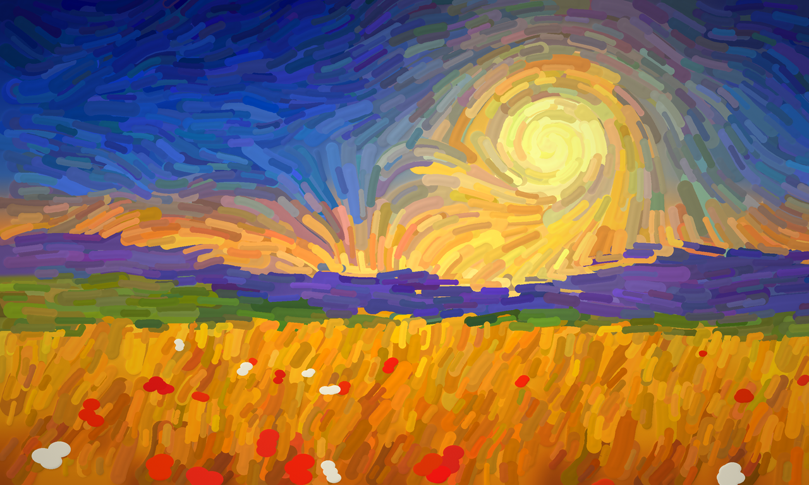
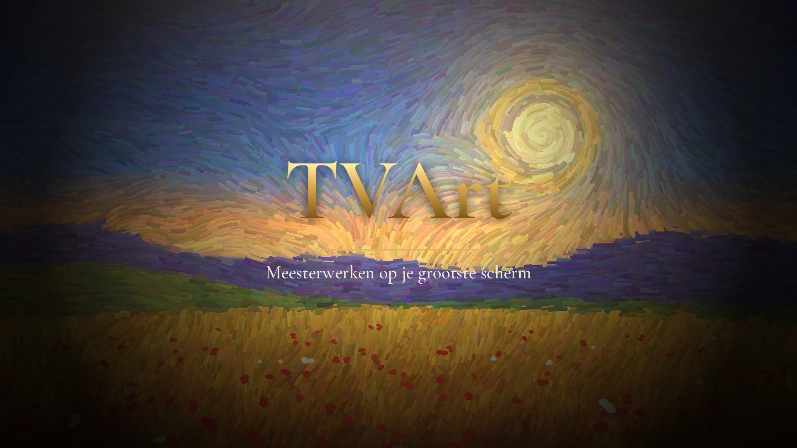
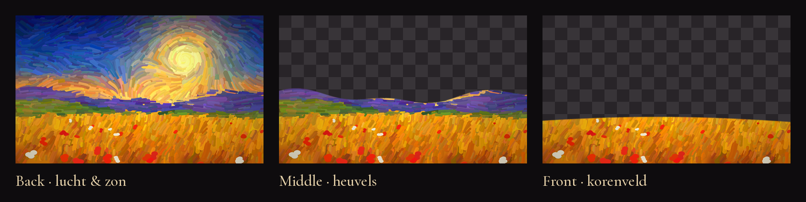
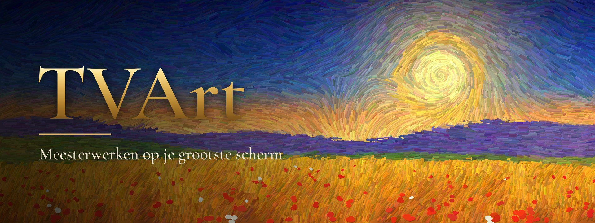

<p align="center"></p>

# TVArt · Apple TV

Jouw museum, op het grootste scherm. TVArt is een native SwiftUI-app voor Apple TV die meesterwerken uit openbare museumcollecties schermvullend als tentoonstelling toont.

**Bundle ID** `nl.lrvdlinden.tvart` · **Versie** `1.0.0` · **Build** `5` · **tvOS** 17.0+

📦 **Download Xcode-project:** [`releases/TVArt-v1.0.0-build5.zip`](releases/TVArt-v1.0.0-build5.zip)



## Functies

- Kies een kunstenaar of collectie: Van Gogh, Rembrandt, Monet, Vermeer, Frans Hals, Mondriaan, Gauguin, Manet, Munch, Goya, Cézanne, Renoir, Degas, Turner, Hokusai, Botticelli, Klimt en de Renaissance.
- Volledig Nederlands en Engels, volgt de taal van de Apple TV.
- Honderden werken per meester via Wikidata/Wikimedia Commons (Van Gogh: 889), gesorteerd op bekendheid, met titels in je eigen taal.
- **Screensavers** per thema (Alle meesters, Landschappen, Portretten, Stillevens & bloemen, Stad & architectuur, Zee & water, Dagelijks leven, Favorieten) die automatisch starten na een ingestelde tijd.
- Tentoonstellingsmodus met vloeiende overgangen, langzame Ken Burns-zoom en een museumbordje per werk.
- Tijd per werk: 20 / 30 seconden of 1 / 2 / 5 / 8 minuten; willekeurig of op volgorde.
- Weergave Automatisch / Volledig werk / Beeldvullend, met vervaagde achtergrond bij staande werken.
- Favorieten als eigen collectie, zwevende klok, instellingen in Apple TV-stijl die vanzelf sluiten (tegen inbranden).
- Geen account of API-sleutels: alles live uit openbare musea-API's.

### Bediening (Siri Remote)

| Knop | Actie |
|---|---|
| ◀ ▶ | Vorig / volgend werk |
| ▲ | Favoriet aan/uit |
| ▼ of klik | Museumbordje tonen |
| ⏯ | Pauze / hervat |
| Klik ingedrukt houden | Instellingen |
| Menu | Bordje verbergen / terug |

## Huisstijl

| App-icoon (3 parallax-lagen) | Top Shelf |
|---|---|
|  |  |

Het app-icoon is het volledige schilderij in 3 parallax-lagen (lucht & zon · heuvels · korenveld). Het schilderij in icoon, splash en Top Shelf is een eigen, procedureel gegenereerd impasto-landschap (geen bestaand kunstwerk). De bronscripts staan in [`BrandingSource/`](BrandingSource) — draai `brand.py` en `icon_full_painting.py`, daarna `export_assets.py` om alles opnieuw te genereren. Lettertype: Cormorant Garamond (SIL Open Font License, zie `TVArt/Fonts/OFL.txt`).

## Openen in Xcode

1. Open `TVArt.xcodeproj` in Xcode 16 of nieuwer.
2. Kies het schema **TVArt** en een Apple TV-simulator of je Apple TV.
3. Team staat op `EU3UY476T6` (automatisch signeren).
4. Build & run (⌘R).

## Projectstructuur

```
TVArt.xcodeproj
TVArt/
  TVArtApp.swift        App + root (splash → home)
  SplashView.swift      Animatie-splashscreen
  Theme.swift           Kleuren, typografie, woordmerk
  HomeView.swift        Startscherm, kunstenaarskaarten, favorieten
  GalleryView.swift     Raster met werken per kunstenaar
  SlideshowView.swift   Tentoonstellingsmodus
  SettingsView.swift    Instellingen (tvOS Settings-stijl)
  MuseumService.swift   Wikidata/Commons + The Met + Cleveland, schijfcache
  ScreensaverView.swift Screensavers per thema
  ActivityMonitor.swift Detecteert inactiviteit voor automatische screensaver
  Settings.bundle       Instellingen in de Apple TV-Instellingen-app
  ImagePipeline.swift   Laden, cachen, vooraf ophalen van beelden
  Assets.xcassets       App Icon & Top Shelf brand assets, SplashArt
  Localizable.xcstrings Nederlands + Engels
  Fonts/                Cormorant Garamond
```

## Bronnen & rechten

- Wikidata Query Service + Wikimedia Commons (hoofdbron, afbeeldingen van publiek-domeinwerken): https://query.wikidata.org/
- The Metropolitan Museum of Art Collection API (v1.1 search): https://metmuseum.github.io/
- Cleveland Museum of Art Open Access API (CC0): https://openaccess-api.clevelandart.org/
- Collecties worden 7 dagen gecachet op het apparaat. Het Art Institute of Chicago is niet meer bruikbaar (beeldserver blokkeert apps).
- Alleen werken die de bron als publiek domein markeert worden getoond. Controleer de gebruiksvoorwaarden van de musea vóór commerciële publicatie.

Zie [CHANGELOG.md](CHANGELOG.md) voor alle wijzigingen.
